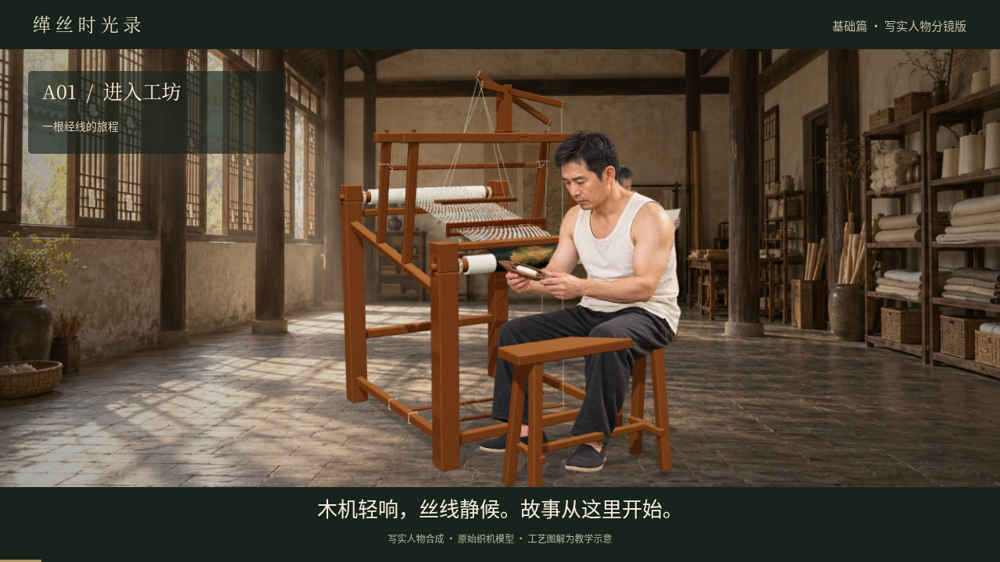
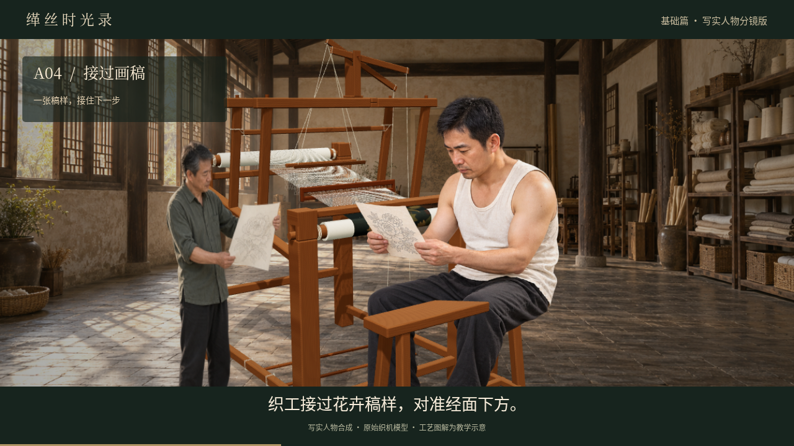
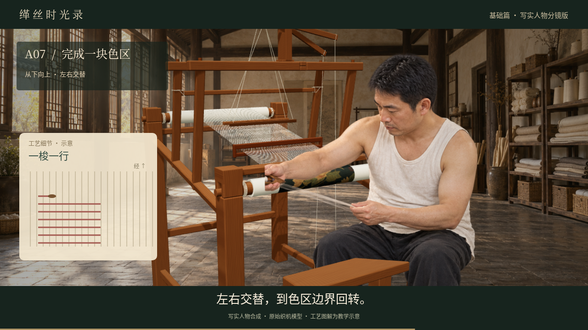

# 缂丝时光录 · A01—A09 写实人物分镜版

[下载新版完整 MP4](https://github.com/ling12697/kesi-qianlong-game/raw/refs/heads/video-a01-a09-first-cut/video/a01-a09-realistic/A01-A09-realistic.mp4)

请下载后使用手机相册或电脑播放器打开；GitHub 文件页不一定直接显示播放器。

以用户上传的《中国缂丝游戏分镜脚本》基础篇为依据，按九镜顺序制作，时长 2 分 54 秒。新版替换初版的简化三维角色，使用 AI 生成的写实成年中国男织工：白色无袖棉上衣、黑裤、黑布鞋；另配独立的画师与工坊素材。

## 成片形式

这是**写实人物姿态与三维织机合成的分镜短片（2.5D）**：包含画面推进、不同工序的人物姿态切换、独立工艺图解、中文合成男声旁白、字幕和工具拟音。人物主体来自生成图片，不是逐帧生成的真人连续表演；没有口型同步。投梭、手部接触及工艺变化仍是示范表达，尚未经专业动作审核。

## 原模型保护

直接读取用户上传的 GLB 副本。原始文件、几何、材质和各节点变换未修改，未重新生成或导出织机。仅启用渲染器的光照与投影显示。人物、工坊和教学图解均在独立对象或图层中。

原模型 SHA-256：
`23caa52aaa02af6f9a0bd81529e7498821263cc11b89b83ba6d16397a1b2e8bd`

## 镜头

| 镜号 | 内容 | 视频时间 |
| --- | --- | --- |
| A01 | 进入工坊 | 00:00—00:12 |
| A02 | 看清人和织机 | 00:12—00:30 |
| A03 | 整经与上机 | 00:30—00:52 |
| A04 | 接过画稿 | 00:52—01:08 |
| A05 | 依样画稿 | 01:08—01:30 |
| A06 | 看懂通经断纬 | 01:30—01:46 |
| A07 | 完成一块色区 | 01:46—02:14 |
| A08 | 拨紧与看织面 | 02:14—02:32 |
| A09 | 修毛与作品亮相 | 02:32—02:54 |

## 技术与声音

画面：1280×720，24fps，H.264 Baseline，AAC 音轨，MP4 快速启动。

旁白：使用 Sherpa-ONNX 2.0.0 和 k2-fsa 官方发布的 `vits-zh-hf-fanchen-C` 模型，通用合成音色 40；不是模仿或克隆指定人士的声音。语音输入对罕见字“缂”使用标准同音“刻”，画面字幕保留正确文字。配乐与拟音为程序合成。

运行所需的图片、原模型、Three.js 和语音模型保留在云环境项目目录。`film.js`、`render.py` 与 `voice.py` 分别负责合成镜头、录制画面和生成旁白，`output/model-integrity.json` 记录模型及素材校验值。
