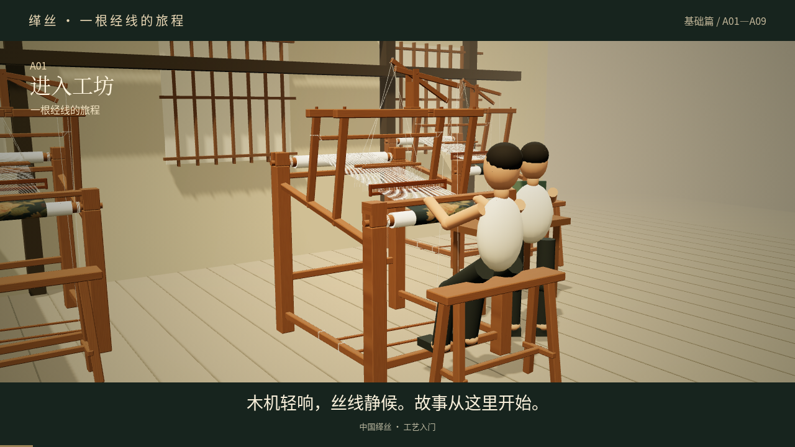

# 缂丝 · 一根经线的旅程（A01—A09）

[下载完整 MP4 视频（约 8MB）](https://github.com/ling12697/kesi-qianlong-game/raw/refs/heads/video-a01-a09-first-cut/video/a01-a09/A01-A09.mp4)

如 GitHub 文件页没有播放器，请使用上面的下载链接，保存后用手机相册、浏览器或电脑播放器打开。

依据《中国缂丝游戏分镜脚本》基础篇 A01—A09 制作的首版三维分镜动画。全片 2 分 54 秒，960×540，16:9，24fps，H.264 Baseline / AAC，已内嵌中文字幕。包含原创合成配乐和工具拟音，暂无人声配音。人物为简化三维角色，动作属于首版分镜演示。

镜头顺序：进入工坊 → 看清人和织机 → 整经与上机 → 接过画稿 → 依样画稿 → 看懂通经断纬 → 完成一块色区 → 拨紧与看织面 → 修毛与作品亮相。

上传的原始织机模型未修改，渲染副本与上传文件的 SHA-256 一致：

`23caa52aaa02af6f9a0bd81529e7498821263cc11b89b83ba6d16397a1b2e8bd`

为保持原模型结构、材质和已有织物不变，工艺变化通过新增道具与独立教学图解表现。互动环节已改编为自动演示；对白及衔接文字属于创作内容。尚未制作皇家篇与传承篇。

附带 [中文字幕文件](A01-A09.zh-CN.srt)。本分支只新增视频交付目录，不改动原游戏页面或模型。
