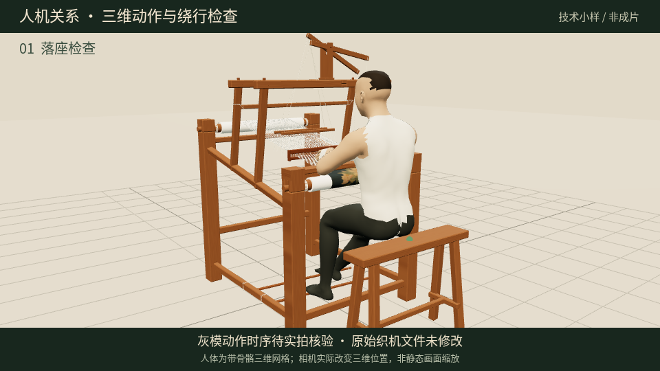
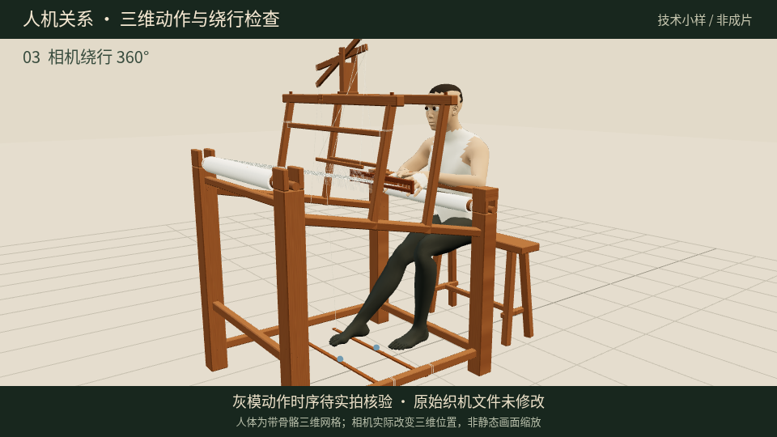

# A01—A09 人机关系、动作与运镜核对

[下载 32 秒三维坐姿、骨骼动作与 360° 绕行检查小样（约 5MB）](https://github.com/ling12697/kesi-qianlong-game/raw/refs/heads/video-a01-a09-first-cut/video/motion-study/seat-motion-orbit-study.mp4)

这是技术检查用的三维灰模，不是新版 A01—A09 成片。它验证人体网格和相机确实在三维空间变化，不表示灰模动作已经符合缂丝工艺。

本文件区分已观察到的证据、从原模型计算的结果、参考图能说明的内容，以及尚待实拍核实的事项。不是工艺考证结论，也不是新版成片验收报告。

## 上一版的实际错误

1. 写实男织工来自一张图片，被放到三维平面上。图片里的臀部、腿、脚没有对应的三维表面，无法正确约束原模型凳面和脚踏的接触。
2. 每镜的场景被缓存为一张合成图，随后缩放、平移；人物没有连续的骨骼动作，画面缩放也没有三维绕行的视差。
3. 人物更换姿态后，手部工具、原模型织口和脚踏的位置没有重新求解。真人外观不能补救这些空间和动作错误。

## 证据来源与使用边界

| 来源 | 已实际读取 | 可以支持 | 不能据此认定 |
| --- | --- | --- | --- |
| 用户上传《中国缂丝游戏分镜脚本》 | 是 | A01—A09 工艺顺序、人物设定、各镜的画面和交互目标、镜头切换原则 | 具体脚踏行程、手部动作幅度与关节角度 |
| 用户最新提供的人机关系图片 | 是，视觉观察 | 织工面向织口、臀部落在凳面、腿进入机架下方、脚接触脚踏、双手在经面前缘工作 | 图像是否实拍、连续动作、哪只脚对应哪组综、传动时序 |
| 用户原始 `kesi_loom_peony.glb` | 是，解析节点、几何边界和动画 | 机件和凳面在原模型中的位置、原文件动画类型 | 模型坐标等于已经核实的实物尺寸、作者未提供的工作动作 |
| MakeHuman 官方公开人体、骨架和权重数据 | 是 | 三维人体网格、关节层级、分段长度、皮肤绑定；文件许可标注 CC0 | 缂丝工艺动作、特定织工真人身份或表演 |
| 故宫博物院缂丝网页 | 未读到正文；代理返回 403 | 只能记录访问受阻 | 不能引用为已查阅的工艺证据 |
| 中国丝绸博物馆网页 | 未读到正文；代理返回 403 | 只能记录访问受阻 | 不能引用为已查阅的操作证据 |
| B 站公开检索及作品信息接口 | 已取得下列两段作品的标题、作者、时长和公开播放信息；媒体流被代理 403 拦截 | 能定位具体候选资料 | 尚未观看，不能认定其中的手脚姿态、动作时序或运镜 |

### 已定位的具体操作/纪录片资料（尚未观看视频）

1. [匠人集：缂丝传承人王建江访谈](https://www.bilibili.com/video/BV1Mm4y1D7df/)。作品标题《【非遗缂丝】中国不是没有奢侈品，是奢侈起来，你买不起！》，作者“匠人集”，作品信息注明“缂丝传承人王建江”，时长约 126 秒。
2. [中国传统手工艺纪录片之《重走织造局·缂丝》（Demo）](https://www.bilibili.com/video/BV1XW411H71c/)。投稿作者“臀新”，时长约 325 秒；检索结果的作品说明署名光合传媒及摄影指导/剪辑 Teaci，并给出原作品入口。

当前已经能够使用保持 TLS 校验的原生读取取得公开作品信息。公开播放信息指向 `upos-sz-mirrorcosov.bilivideo.com`，但该媒体流请求被代理拒绝（Tunnel 403）。这一精确域名已追加到环境配置草稿；运行时当前自定义域名仍为空，草稿保存不代表网络变更已经生效。需要在环境设置审阅、保存并发布后继续读取。也可由用户直接上传可研究的操作实拍片段。

浏览器所需的代理 CA 导入被自动审批拒绝，拒绝理由为“持久扩大 HTTPS 证书信任范围，缺少对该安全设置修改的明确授权”。该修改未执行，也没有关闭 TLS 校验。当前采取的原生读取继续使用已有的受信 CA。该证书修改不是继续读取公开作品信息的必要条件，不应为了它额外请求不必要的安全设置授权。

待访问的资料入口：

- 故宫缂丝介绍：<https://www.dpm.org.cn/lemmas/239962.html>
- 中国丝绸博物馆：<https://www.chinasilkmuseum.com/>
- 缂丝操作视频检索入口：<https://search.bilibili.com/>

这些域名已追加至环境配置草稿；草稿保存不等于已开放运行环境网络。仍需在环境设置审阅、保存并发布后重试。未观看操作视频，不宣称已依据视频逐帧核对。

## 从原 GLB 计算的空间关系

下表为原模型作者坐标，保持原模型文件、机件几何、材质和相对位置不变。人体尺度尚处于校准阶段，不能将数字当作已经测量的实物米制尺寸。

| 部位 | 原模型坐标与含义 |
| --- | --- |
| 凳面 | X 约 −0.565～+0.565；Y 约 0.8145～0.8755；Z 约 1.2925～1.5175 |
| 卷布轴中心 | 约 `(0, 1.265, +0.78)`，织工位于这一端的外侧 |
| 经轴中心 | 约 `(0, 1.585, −0.78)` |
| 已织织物前部 | Y 约 1.207～1.359；Z 约 0.61～0.838 |
| 近侧脚踏 | 横向沿 X 展开；Z 中心约 +0.28 |
| 远侧脚踏 | 横向沿 X 展开；Z 中心约 −0.06 |
| 模型自带动画 | `Exploded_view`，66 个节点的拆解位移动画；不是织造工作循环 |

因此，织工应位于 +Z 的卷布端，面向 −Z。坐姿不能只把人物图片贴到凳子附近：骨盆位置、臀部体积、凳面上表面、膝盖弯曲方向、脚底与脚踏接触面必须共同求解。

## 三维重建的技术做法与当前验证

- 人物换为独立三维人体网格和骨架，使用官方绑定权重；不是面向相机的图片平面。
- 上臂/前臂和大腿/小腿分别按两个真实关节解算。用于变形的 01/02 骨段不当作额外的肘或膝，避免手臂或腿在中段反折。
- 手腕与脚踝有独立空间目标；脚的朝向保持与人体坐姿一致。
- 骨盆落座后，使用三角网格与原凳面做表面相交检查。目前 11 个抽样姿态检测到的凳面表面交叉数均为 0。抽样通过不等于所有帧、所有机件均通过碰撞检查。
- 手腕/脚踝首帧目标残差写入 `rig-fit.json`；完整骨骼采样写入 `camera-bone-samples.json`。
- 当前灰模的人体比例、服装、手握工具、脚底接触、提综传动和工艺节奏仍需继续审核，不能把它作为完成的写实角色或正确缂丝表演。

### 当前动作的限定

技术小样只演示可变形人体、手脚目标和相机绕行。循环频率、幅度属于测试值，未从实拍提取。没有播放原文件的拆解动画，亦没有把拆解动作冒充提综和投梭。

在实际操作资料可访问后，需要逐帧记录：准备/开口、过梭、到色区边界回转、拨紧、换脚/换色各自发生的时点；记录梭子与哪只手保持接触，拨子接触织口的方向，以及脚踏与提综的对应关系。脚踏、综、梭、手不能各自循环。

## 相机应该怎样移动

三维绕行必须改变相机在世界中的位置，并一直注视工作区域。当前检查代码使用：

`camera = (centerX + r·sin(θ), height, centerZ + r·cos(θ))`

随后 `lookAt(工作区域)`。相机绕行时，人体、经线、机架和凳子会发生不同的遮挡变化；不是旋转整张图片，也不是只放大画面。

小样中 360° 用于检查穿插和观察各面，**不作为正式影片每镜都绕一圈的拍法**。正式 A01—A09 应按脚本控制镜头：

| 镜号 | 镜头和动作关系 |
| --- | --- |
| A01 | 门口全景向工坊缓慢推进，建立同一台织机和人物位置，不以整圈旋转代替入场 |
| A02 | 中景同时读清臀部、手、脚和织口；可用短弧线从后侧到侧面，再停稳展示工具 |
| A03 | 经面近景锁定，线组排齐过程不跟着旋转 |
| A04 | 画师与织工中景同框，交稿时纸张始终有持握关系；交接完成后才切镜 |
| A05 | 移到经面上方的俯视近景，机架和人体的方向与前镜一致；描画时锁定 |
| A06 | 经线/局部色纬微距演示；放大画面保留方向参照，不能用不准确生成图替代经纬关系 |
| A07 | 固定操作近景，保留本色区边界和逐行上移方向；镜头不能掩盖手梭接触或跳行 |
| A08 | 拨子与织口手部特写，先落稳相机，再拍拨紧；动作方向需要实拍核验 |
| A09 | 待整理一面的余头特写，剪刀接触明确，完成后拉回作品与稿本同框，再停留收束 |

## 下一次制作的通过条件

1. 同一姿态从正面、侧面、后侧都成立；凳面不穿体，腿不反折，脚底不悬空穿踏板。
2. 手与工具有持续接触；工具不悬浮转移，人体与机架不靠镜头遮挡掩盖穿插。
3. 提综、过梭和拨紧按实拍核准的单一动作时序驱动。
4. 相机运动由三维轨迹生成；操作镜头按脚本保持稳定。
5. 先检查一段短动作，再扩展至 A01—A09；不过关的小样不称作新成片。

## 三维人体数据来源

- <https://github.com/makehumancommunity/makehuman>
- 原始人体：`makehuman/data/3dobjs/base.obj`
- 骨架：`makehuman/data/rigs/default.mhskel`
- 权重：`makehuman/data/rigs/default_weights.mhw`
- 男性人体形态：`makehuman/data/targets/macrodetails/asian-male-young.target` 等

上述数据文件内部标注 CC0；这里只将其用于可检查的动作灰模，不将其冒充用户此前确认的写实人物定妆。
